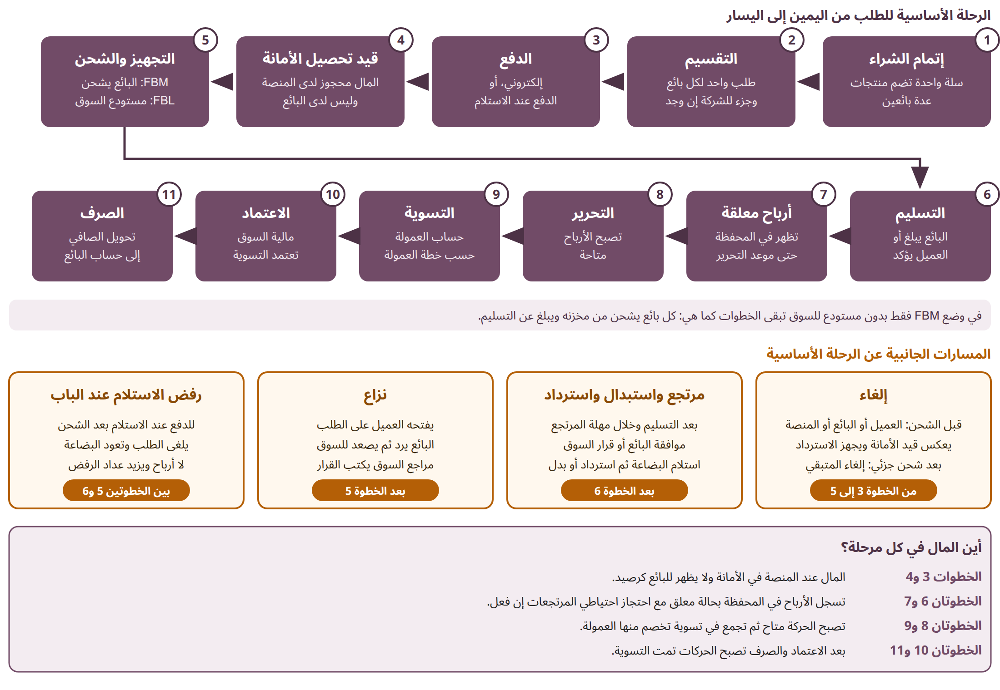

# مقدمة

هذا الفصل يعطيك الصورة الكاملة قبل أن تدخل في تفاصيل الشاشات: ماذا يفعل النظام، ومن يستخدمه وبأي صلاحيات، وما الذي يحدث لطلب واحد من لحظة الشراء إلى لحظة وصول المال إلى حساب البائع، وما الفرق بين وضعي المستودع، وأهم المصطلحات.

## ماذا يفعل النظام {: .vendor }

«ليدرز ماركت بليس» سوق إلكتروني متعدد البائعين على أودو 18. فيه أربع وظائف رئيسية:

1. **البيع:** كل بائع معتمد يعرض منتجاته في المتجر الإلكتروني للسوق. عرض البائع (Offer) يحدد سعره ومخزونه ونمط تنفيذه. وإذا عرض عدة بائعين المنتج نفسه فإن «صندوق الشراء» (Buy Box) يختار العرض الذي يظهر افتراضيًا للعميل حسب السعر والتقييم والتوفر وسرعة التنفيذ ومستوى البائع.
2. **التحصيل بالأمانة:** العميل يدفع للسوق لا للبائع. تحتفظ المنصة بمال البائع في حساب أمانة، ويظهر ذلك في قيد يومية اسمه «قيد تحصيل الأمانة»، ولا يكسب البائع المال فعليًا إلا بعد التسليم.
3. **التنفيذ:** إما أن يشحن البائع بنفسه من مخزنه (FBM)، وإما أن يودع بضاعته في مستودع السوق فيشحن المستودع (FBL).
4. **التسوية والصرف:** بعد التسليم تظهر أرباح البائع في «محفظته». تجمع المالية الأرباح المتاحة في «تسوية» لفترة محددة، وتخصم منها العمولة حسب «خطة العمولة» الخاصة بالبائع، ثم تعتمد التسوية وتصرف الصافي للبائع.

> **ملاحظة:** العمولة لا تُخصم من كل طلب على حدة. الطلب يبقى بمبلغه الكامل، وتُحسب العمولة عند إنشاء التسوية على مبيعات الفترة كلها حسب خطة البائع. وإذا لم تكن للبائع خطة فالإعداد «البائعون بدون خطة عمولة» يحدد: «عدم احتساب أي رسوم» (الافتراضي)، أو «احتساب معدل مستوى البائع».

## الأدوار وصلاحياتها

النظام يعرف تسعة أدوار. أربعة منها مجموعات صلاحيات في وحدة السوق (مدير السوق، المراجع، المالية، ومالك البائع وموظفه)، والباقي مستخدمو أودو عاديون.

| الدور | كيف يُعرَّف | ماذا يستطيع |
|---|---|---|
| مدير النظام | مجموعة أودو «الإعدادات» | كل شيء، ومنه شاشة الإعدادات ← السوق التي تفعّل وتعطل الميزات وتضبط الحسابات المحاسبية |
| مدير السوق | المجموعة «مدير السوق»، وتشمل تلقائيًا صلاحيات المراجع والمالية | تنفيذ كل عمليات السوق: تأكيد التسليم في الواجهة الخلفية وإكمال الطلبات، وإلغاء طلبات البائعين، وإلغاء المتبقي من الشحنات الجزئية، وتسجيل رفض العميل عند الباب، ومستويات البائعين وسياسة صندوق الشراء وأسباب الإلغاء والإرجاع ومناطق التسليم، واستيرادات البائعين ومفاتيح API، ومزودو الشحن، ومؤشرات الأداء والعقوبات |
| مراجع السوق | المجموعة «مراجع السوق» (مستخدم داخلي) | مراجعة طلبات انضمام البائعين ومستنداتهم، واعتماد المنتجات والعروض أو رفضها أو تعليقها، واعتماد الخصومات الكبيرة، وقرار المرتجعات المصعّدة وحسم النزاعات، وإدارة أسئلة المنتجات. يقرأ الطلبات والتقارير ولا يغيّرها |
| مالية السوق | المجموعة «مالية السوق» (تشمل مستخدم المحاسبة في أودو) | إنشاء التسويات واعتمادها وإلغاؤها وتسجيل صرفها، واعتماد أو رفض طلبات تغيير حساب صرف المستحقات، وقراءة المحفظة وخطط العمولة وفواتير البائعين، وتسجيل مدفوعات الاسترداد |
| أمين المستودع | مستخدم داخلي بصلاحية «مستخدم المخزون» ولا توجد له مجموعة خاصة بالسوق | اعتماد أذون التسليم من مستودع السوق (بضاعة FBL) واستلام مرتجعاتها، ومعالجة واردات FBL. لا يرى أموال البائعين |
| مالك البائع | المجموعة «مالك البائع» (مستخدم بوابة) | كل ما يفعله الموظف، وحده: الملف الشخصي وطلب تغيير حساب صرف المستحقات، والمحفظة والتسويات وطلب تسوية وكشف الحساب، وتأكيد الطلب وإلغاؤه وتأكيد استلام النقدية، وإدارة الموظفين ومناطق التسليم ومفاتيح API، وقبول شروط البائع |
| موظف البائع | المجموعة «موظفو البائع» (مستخدم بوابة) | إدارة المنتجات والعروض والمخزون والخصومات والاستيراد، وشحن الطلبات والإبلاغ عن التسليم وتسجيل الرفض عند الباب، والرد على المرتجعات والنزاعات وأسئلة العملاء، وقراءة الأداء. لا يدخل صفحات المال |
| العميل | مستخدم بوابة عادي | التسوق والدفع، ومتابعة طلباته من «طلباتي»، وإلغاؤها وطلب مرتجع أو فتح نزاع حسب الإعدادات |
| الزائر | بلا تسجيل دخول | تصفح المتجر وصفحات المتاجر، وتقديم طلب انضمام كبائع من `/vendor/apply` (عند تفعيل «طلب انضمام بائع عام») |

> **ملاحظة:** الصلاحية مقيدة أيضًا بقواعد السجلات: مالك البائع وموظفه لا يريان إلا سجلات بائعهما (عروض، طلبات، مرتجعات، نزاعات، فواتير، مناطق تسليم)، والمحفظة والتسويات لا يقرؤها إلا المالك. وإجراءات الواجهة الخلفية (الاعتماد والإلغاء والدفع) لها قفل ثانٍ في الشفرة يمنع تنفيذها من غير مجموعتها حتى لو استُدعيت مباشرة.

## أدوار البائع {: .vendor }

لكل بائع مالك واحد على الأقل وعدد من الموظفين. يُنشأ المالك تلقائيًا عند اعتماد طلب الانضمام، ويدعو المالك موظفيه من صفحة «الموظفون» في البوابة.

| المهمة | المالك | الموظف |
|---|---|---|
| إضافة منتج جديد أو عرض على منتج موجود، وتعديل السعر والمخزون والخصم | نعم | نعم |
| الاستيراد الجماعي للمنتجات | نعم | نعم |
| شحن الطلب وتسجيل رقم التتبع وطباعة بوليصة الشحن | نعم | نعم |
| الإبلاغ عن التسليم وتسجيل رفض العميل عند الباب | نعم | نعم |
| الموافقة على المرتجع أو رفضه والرد على النزاع والإجابة عن أسئلة العملاء | نعم | نعم |
| تأكيد الطلب الذي ما زال «قيد الانتظار» | نعم | لا |
| إلغاء الطلب (إن فُعّل «يمكن للبائعين إلغاء الطلبات») | نعم | لا |
| تأكيد استلام النقدية لطلب الدفع عند الاستلام | نعم | لا |
| المحفظة والتسويات وطلب تسوية وكشف الحساب وفواتير التسوية | نعم | لا |
| الملف الشخصي وتغيير حساب صرف المستحقات | نعم | لا |
| إدارة الموظفين ومناطق التسليم ومفاتيح API | نعم | لا |
| قبول شروط البائع | نعم | لا (يرى صفحة تنبيه حتى يقبلها المالك) |

عند ظهور رسالة تبدأ بـ «يمكن لمالك البائع فقط ...» أو «مالك البائع فقط يمكنه ...» فالسبب أن الصفحة أو الإجراء للمالك وحده.

## رحلة الطلب من البداية إلى النهاية {: .vendor }

يوضح الرسم التالي الرحلة الأساسية للطلب والمسارات الجانبية. الأرقام في الرسم هي أرقام الفقرات في الشرح بعده.

### الرحلة الأساسية {: .vendor }

**1. إتمام الشراء.** يضع العميل في سلته منتجات من بائع واحد أو أكثر، وقد يضع معها منتجات تبيعها الشركة نفسها (منتجات الشركة). العميل يدفع مرة واحدة ويستلم إشعارًا واحدًا.

**2. التقسيم إلى طلبات بائعين.** عند تأكيد السلة ينقل النظام سطور كل بائع إلى «طلب بائع» مستقل (`VO/000001` وهكذا)، ويبقى ما يخص الشركة في أمر البيع الأصلي (`S00002` مثلًا). إذا كانت السلة كلها لبائعين فقط فإن أمر البيع الأصلي يُلغى تلقائيًا (بتصميم النظام) وتبقى طلبات البائعين. يوزّع النظام رسوم التوصيل على البائعين حسب منطقة التسليم لكل بائع، فإذا كان البائع لا يوصل إلى محافظة العميل ظهر الخطأ «(اسم البائع) لا يوصّل إلى (المحافظة).» ولم تتم العملية.

**3. الدفع.** خياران: الدفع الإلكتروني (فتنجح المعاملة ويتأكد الطلب)، أو الدفع عند الاستلام (COD) إن فعّله المدير من الإعداد «السماح بالدفع عند الاستلام»؛ وله حد أقصى للمبلغ (الافتراضي في العرض 5000 ج.م)، ويمكن اشتراط التحقق من الهاتف برمز، ويُحظر على العميل بعد عدد معين من حالات الرفض (3 في العرض).

**4. قيد تحصيل الأمانة.** عند تأكيد طلب البائع في الدفع الإلكتروني يسجل النظام قيدًا: مدين «حساب العميل المدين»، دائن «الأمانة (مبالغ البائعين المحتجزة)» بمبلغ طلب البائع كاملًا، ثم يسوّي دفعة العميل على هذا المدين. مثال من بيانات العرض، الطلب `VO/000003` (بيت الأثاث الحديث، كرسي مكتب):

| الحساب | مدين | دائن |
|---|---|---|
| Account Receivable (121000) | 2,760.00 | |
| ضمان أموال البائعين (219000) | | 2,760.00 |

في الدفع عند الاستلام لا يُسجَّل شيء من هذا عند التأكيد: البائع (FBM) يحصّل النقود بنفسه، ولا تمر الأمانة على المنصة.

**5. التجهيز والشحن.** يبدأ طلب البائع «قيد الانتظار» ثم «مؤكد» حال قبول السلة، وفي هذه اللحظة يحدث كل التالي: يُحدد «موعد الشحن» (وقت التأكيد زائد مهلة الشحن SLA: يومان افتراضيًا أو مهلة مستوى البائع)، وتُنشأ «مجموعات التنفيذ» وأذون التسليم، وتُصدر فاتورة البائع للعميل، ويصل البائع إشعار «تم تأكيد طلب جديد».
- **FBM:** يفتح البائع الطلب في البوابة ويضغط الشحن، ويكتب «رقم التتبع» (إلزامي لشحنات FBM، وإلا ظهرت الرسالة «رقم التتبع مطلوب لشحنات FBM.»)، ويستطيع تعديل الكميات فيشحن جزءًا الآن ويبقى الباقي في شحنة ثانية من المجموعة نفسها. تصبح مجموعة التنفيذ «تم الشحن جزئيًا» حتى تُشحن كل الأذون.
- **FBL:** لا يشحن البائع. أمين المستودع يعتمد إذن التسليم في المخزون فتصبح المجموعة «تم الشحن»، وتُحسب على البائع «رسوم التنفيذ» إن وُجدت.
- إذا مر موعد الشحن دون شحن يُعلَّم الطلب «متأخر» (مهمة كل ساعة)، وتُنشأ مهمة للمراجعين ويصل البائع إشعار.

**6. التسليم.** يعتمد على نمط التنفيذ والإعداد «تأكيد التسليم لـ FBM»:
- الوضع الافتراضي «البائع يؤكد التسليم»: البائع يضغط «تحديد كـ تم التسليم» (ويرفق صورة إثبات اختياريًا) فتصبح المجموعة «تم التسليم» فورًا.
- الوضع «العميل يؤكد التسليم»: يبلّغ البائع فتنتقل المجموعة إلى «تم الإبلاغ عن التسليم» وتنتظر العميل، فإما يؤكد الاستلام، وإما يضغط «لم أستلمه» فيُفتح نزاع، وإما يمر عدد أيام «تأكيد التسليم تلقائياً بعد (أيام)» (3 افتراضيًا) فتؤكد المهمة المجدولة التسليم.
- في FBL يؤكد مدير السوق التسليم من الواجهة الخلفية (زر «تم التسليم») أو يصله من مزود شحن مربوط.
عندما تتسلم كل المجموعات يصبح طلب البائع «مكتمل».

**7. أرباح معلقة.** عند اكتمال الطلب (أو عند اكتمال شحنه إذا كانت سياسة مستواه «عند الشحن») ينشئ النظام حركة «الأرباح» في محفظة البائع بحالة «معلّق»، بمبلغ صافي الطلب (الإجمالي ناقص رسوم التنفيذ)، مع تاريخ إتاحة يحدده «سياسة تحرير الأمانة» لمستوى البائع: «عند الشحن» أو «عند التسليم» أو «التسليم + X أيام». وإذا فُعّل «احتجاز احتياطي مرتجعات» أُضيفت حركة سالبة بنسبة احتياطي المستوى تحجز جزءًا من الأرباح للمرتجعات. وفي الوقت نفسه يسجل قيد تحرير الأمانة:

| الحساب (طلب `VO/000003`) | مدين | دائن |
|---|---|---|
| ضمان أموال البائعين (219000) | 2,760.00 | |
| مستحقات البائعين (219100) | | 2,745.00 |
| إيراد رسوم الشحن والتخزين (419100) | | 15.00 |

**8. التحرير.** مهمة مجدولة يومية («السوق: تحرير المبالغ المحتجزة في محافظ البائعين») تحول كل حركة «معلّق» بلغ تاريخ إتاحتها إلى «متاح».

**9. التسوية.** حركات «متاح» تُجمع في «تسوية» لفترة زمنية. ينشئها المالك من صفحة المحفظة بزر «طلب تسوية» (الفترة لا تنتهي في المستقبل ولا تتداخل مع تسوية قائمة)، أو تنشئها المالية، أو تنشئها مهمة مجدولة إذا فُعّل «إنشاء التسويات تلقائيًا». عند الإنشاء تُحسب العمولة حسب خطة العمولة (المستهدف أو الإنجاز) كحركة سالبة من نوع «العمولة».

**10. الاعتماد.** تعتمد مالية السوق التسوية (زر «اعتماد»): تحول الحالة إلى «معتمد»، ويُسجَّل قيد العمولة (أو فاتورة عمولة ضريبية إذا كان «فوترة العمولة» على فاتورة)، ويصل البائع إشعار «تم اعتماد التسوية». مثال: التسوية `SET/000003` لبيت الأثاث الحديث (فترة 1 إلى 27 أغسطس 2026):

| البند | المبلغ (ج.م) |
|---|---|
| إجمالي الحركات الموجبة (أرباح) | 4,794.00 |
| عمولة خطة الإنجاز | 162.60 |
| مرتجع `RET/000003` على الطلب `VO/000016` | 1,667.50 |
| احتياطي المرتجعات (102.45 + 137.25) | 239.70 |
| إجمالي الخصومات | 2,069.80 |
| الصافي المستحق | 2,724.20 |

قيد العمولة: مدين «مستحقات البائعين» 162.60، دائن «إيراد عمولة السوق» 162.60.

**11. الصرف.** تضغط المالية «تحديد كمدفوع» فيُسجل قيد الصرف (مدين مستحقات البائع، دائن البنك)، وتصبح التسوية «مدفوع» وحركاتها «تمت التسوية»، ويصل البائع إشعار. يمتنع الصرف إذا كان لدى البائع طلب تغيير حساب بنكي قيد المراجعة (بحسب الإعداد «حظر صرف المستحقات أثناء وجود تغيير بنكي قيد الانتظار») أو إذا كان الصافي سالبًا (البائع مدين للمنصة بنقدية الدفع عند الاستلام)، وفي هذه الحالة تستعمل المالية «تسجيل دفعة البائع» عند استلام المبلغ منه.

### مثال زمني من بيانات العرض {: .vendor }

الطلب `S00002` وضعه `customer2@customer.demo` بتاريخ 10 أغسطس 2026 من بائعين:

| الوقت | الحدث |
|---|---|
| 10 أغسطس 08:27 | يتأكد الطلب ويتقسم إلى `VO/000002` (النور، ساعة ذكية FBM، 1,863.38 ج.م) و`VO/000003` (بيت الأثاث، كرسي FBL، 2,760.00 ج.م). موعد الشحن لكليهما 12 أغسطس 08:27 (مهلة يومين) |
| 11 أغسطس 07:47 | النور يشحن، رقم التتبع `NRT-100202` |
| 11 أغسطس 07:54 | مستودع السوق يشحن كرسي بيت الأثاث |
| 12 أغسطس 06:40 | النور يبلّغ التسليم، ويصبح `VO/000002` «مكتمل». المستوى ذهبي بسياسة «عند التسليم»: الأرباح 1,863.38 «متاحة» فورًا، مع احتياطي 3% = 55.90 |
| 13 أغسطس 06:30 | تسليم كرسي بيت الأثاث. المستوى فضي بسياسة «التسليم + 7 أيام»: الأرباح 2,745.00 (بعد رسوم تنفيذ 15.00) «معلّقة» حتى 20 أغسطس، واحتياطي 5% = 137.25 |
| 20 أغسطس | المهمة اليومية تحول أرباح بيت الأثاث إلى «متاح»، وتدخل التسوية `SET/000003` |

### المسارات الجانبية {: .vendor }

**الإلغاء.** ثلاث جهات تلغي، ولكل منها شرط:
- **العميل:** من صفحة طلبه إذا كان الإعداد «إلغاء الطلب من قبل العميل» مفعّلًا، وقبل شحن أي جزء، وداخل مهلة الإلغاء بالساعات (0 = بلا مهلة). يلغي السلة كلها أو جزء بائع واحد.
- **البائع (المالك):** إذا فُعّل «يمكن للبائعين إلغاء الطلبات»، بسبب إلزامي، وقبل الشحن.
- **المنصة:** مدير السوق بزر الإلغاء في الواجهة الخلفية، وقبل الشحن أيضًا.

في الحالات الثلاث تُلغى أذون التسليم (يتحرر المخزون المحجوز)، ويُعكس قيد الأمانة، ويُجهَّز استرداد للعميل كدفعة **مسودة** تنشرها المالية بعد إرسال المال فعلًا (لا يرسل النظام المال وحده). أما بعد الشحن الجزئي فيبقى الباقي غير المشحون: «إلغاء المتبقي» (في الواجهة الخلفية) يلغي الإذن المفتوح ويعدّل المبالغ للكمية التي شُحنت فقط، وتتحول المجموعة إلى «تم الشحن»، ثم تكمل الرحلة بالكمية المشحونة.

**المرتجع والاستبدال والاسترداد.** بعد الشحن، وخلال «مهلة المرتجع (أيام)» (14 يومًا من أول شحنة)، يطلب العميل مرتجعًا لكميات محددة. الحالات: «مطلوب» ← البائع يعتمد (فتنشأ أذون استلام) أو يرفض (فيُصعَّد للسوق، ويُصعَّد تلقائيًا إذا لم يرد البائع في «استجابة البائع للمرتجع (بالأيام)») ← المراجع يعتمد أو يرفض نهائيًا ← عند استلام البضاعة إلى مخزن البائع (أو مستودع السوق لـ FBL) يصير «تم الاستلام» ثم يُنفَّذ القرار: **استرداد** (يُحسب المبلغ ويُخصم من محفظة البائع مع رد عمولة الكمية المرتجعة، وتُنشأ إشعار دائن ودفعة استرداد للعميل) أو **استبدال** (شحنة بديلة مجانية من مخزون البائع دون حركة مال).

**النزاع.** يفتحه العميل على طلبه (ويُفتح نزاع كذلك عند ضغطه «لم أستلمه» على تسليم أبلغ عنه البائع). الحالات: «مفتوح» ← البائع يرد («رد البائع») ← العميل يراسل أو يصعّد ← «تم التصعيد» فيقرر المراجع ويكتب القرار ويحسم النزاع «تم الحل» أو يغلقه. إذا لم يرد البائع في «اتفاقية مستوى الخدمة للنزاع (بالأيام)» صُعِّد النزاع تلقائيًا.

**رفض الاستلام عند الباب (الدفع عند الاستلام).** عندما يرفض العميل طرد الدفع عند الاستلام بعد شحنه، يسجل البائع (FBM) «رفض العميل الاستلام» (وفي FBL يسجله مدير السوق من الواجهة الخلفية). النتيجة: يُنشأ إذن استلام يعيد البضاعة إلى مصدرها، ويُلغى الطلب، **ولا يُسجَّل ربح ولا استرداد** لأن المال لم يدخل المنصة، ويزيد عداد رفض العميل بواحد. الحالة «تم الشحن» فقط هي التي يجوز رفضها بهذه الطريقة؛ وإذا سلّم البائع وحاول العميل الاعتراض فذلك نزاع.

> **ملاحظة:** الدفع عند الاستلام مع FBM: البائع يحصّل النقود لنفسه، فبعد اكتمال الطلب يجب على المالك أن يضغط «تأكيد استلام النقدية». عندها فقط تُسجَّل حركة «تحصيل الدفع عند الاستلام (بحوزة البائع)» ويتحول المبلغ المستحق عليه للمنصة إلى خصم في التسوية. هذه الحركة لا تدخل في الصافي المصروف لأن البائع يحمل النقود أصلًا.

## وضعا المستودع {: .vendor }

> **ميزة مشروطة:** هذه الميزة تعمل فقط عند تفعيل الإعداد «مستودع السوق (FBL)» من الإعدادات ← السوق ← مالية البائع والمرتجعات. الإعداد مفعّل افتراضيًا. إذا أطفأته فلا يبقى في النظام أي أثر لـ FBL.

يعمل النظام في أحد وضعين:

| | المنصة لها مستودع (FBL مفعّل) | FBM فقط (`fbl_enabled` مطفأ) |
|---|---|---|
| نمط الشحن | البائع يختار لكل عرض: FBM أو FBL | كل بائع يشحن بنفسه دائمًا |
| موقع المخزون | لكل بائع موقع في مخزنه ومنطقة في مستودع السوق للبضاعة FBL | موقع مخزن البائع فقط، ولا يُنشأ موقع FBL |
| حقل نوع التنفيذ في العرض | ظاهر | مخفي؛ الاختيار بـ FBL مرفوض برسالة «Fulfilled by Leaders (FBL) is not available: the marketplace has no warehouse of its own.» (تظهر بالإنجليزية لأن ترجمتها غير مضافة) |
| قوائم الإدارة | «واردات FBL» و«رسوم التنفيذ» ظاهرتان | مخفيتان |
| رسوم التنفيذ ورسوم التخزين | تُحسب على مجموعات FBL | لا تُحسب |
| صندوق الشراء | العرض FBL ينال درجة سرعة شحن أعلى (الافتراضي 1.0 مقابل 0.5 لـ FBM) | لا مكافأة لأحد (الجميع FBM) |
| سياسات التنفيذ (فرض FBL لبائع أو فئة) | تعمل | يُتجاهل ما هو مخزّن منها |
| رسوم التوصيل عند FBL | يحددها الإعداد «رسوم التوصيل لـ FBL» (تذهب للبائع أو للسوق) | لا تنطبق |
| رفض الدفع عند الاستلام عند الباب | البائع لـ FBM، والمدير لـ FBL | البائع دائمًا |

لا يمكن إطفاء الإعداد وهناك عروض FBL نشطة أو مخزون FBL أو شحنات FBL مفتوحة؛ يعرض النظام قائمة بما يمنع الإطفاء.

## المصطلحات الأساسية {: .vendor }

الجدول التالي مختصر. المسرد الكامل في الفصل التاسع.

| المصطلح في الواجهة | المعنى |
|---|---|
| FBM (شحن بواسطة البائع) | البائع يخزن ويشحن ويسلّم بنفسه |
| FBL (شحن بواسطة ليدرز) | البائع يودع بضاعته في مستودع السوق، والمستودع يجهز ويشحن |
| العرض | سعر بائع ومخزونه على منتج، وله حالة (مسودة، قيد المراجعة، نشط، مرفوض، معلق) |
| عرض الكتالوج | عرض جديد على منتج موجود في الكتالوج بدل إنشاء منتج جديد («بيع منتج موجود»)؛ يعمل ضمن الإعداد «عروض الكتالوج والمتاجر والتقييمات» |
| صندوق الشراء (Buy Box) | العرض الفائز الذي يُضاف للسلة افتراضيًا، بأوزان يحددها المدير في «سياسة صندوق الشراء» |
| الأمانة | حساب المنصة الذي يحتجز أموال البائعين بعد الدفع حتى التسليم |
| المحفظة | سجل حركات البائع المالية: الأرباح والعمولة والاحتياطي والمرتجع والغرامات. الحركة «معلّق» أو «متاح» أو «تمت التسوية»، ولا تُعدَّل ولا تُحذف |
| التسوية | جمع حركات «متاح» لفترة، مع العمولة، لصرف صافيها للبائع. حالاتها: مسودة، معتمد، مدفوع، ملغى |
| خطة العمولة | القاعدة التي تحسب عمولة البائع على مبيعات الفترة: خطة «المستهدف» أو «الإنجاز» |
| المستوى (Tier) | فئة البائع (برونزي، فضي، ذهبي، بلاتينية): تحدد معدل العمولة الافتراضي وحد المنتجات وتكرار الصرف ومهلة الشحن وسياسة تحرير الأمانة ونسبة الاحتياطي |
| احتياطي المرتجعات | نسبة من أرباح كل طلب تُحجز لمقابلة المرتجعات (3% في الذهبي، 5% في الفضي، 10% في البرونزي بحسب بيانات العرض)، ولا تُحجز فعلًا إلا عند تفعيل «احتجاز احتياطي مرتجعات» |
| مهلة الشحن (SLA) | عدد الأيام التي يملكها البائع ليشحن بعد تأكيد الطلب؛ ينتج عنها «موعد الشحن» |
| موعد الشحن | تاريخ ووقت آخر حد للشحن، ويُعلَّم الطلب «متأخر» بعده |
| مجموعة التنفيذ | جزء من طلب البائع يخرج من مصدر واحد بنمط واحد (FBM أو FBL)، وله حالته ورقم تتبعه |
| الدفع عند الاستلام (COD) | العميل يدفع نقدًا عند الباب |
